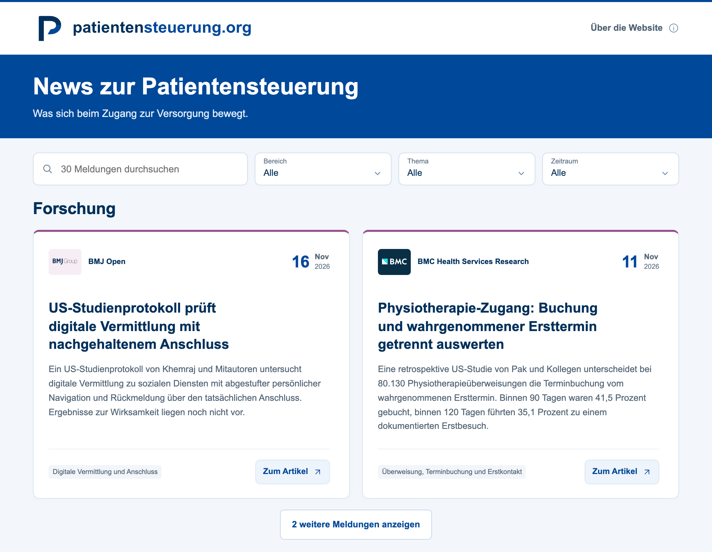
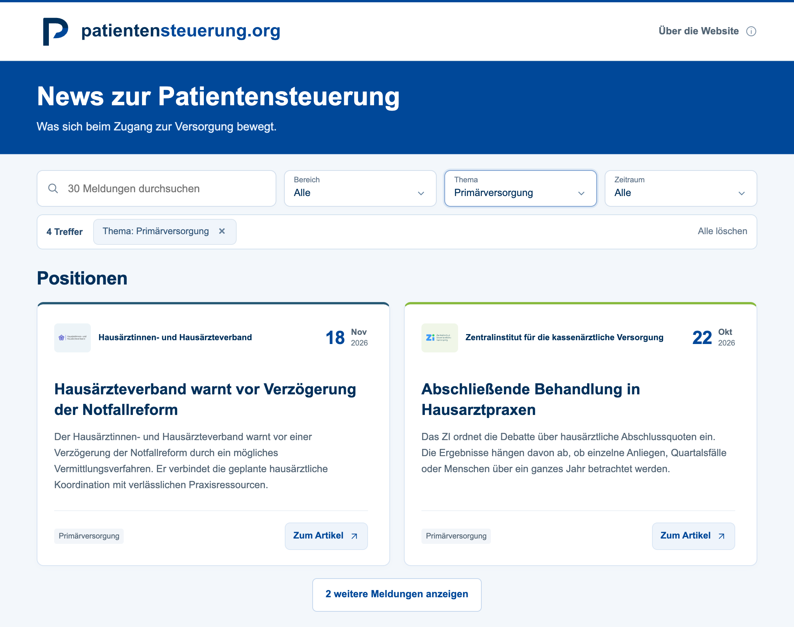

#  Newsfeed OS

**Newsfeed OS überträgt den Aufbau von [Patientensteuerung.org](https://patientensteuerung.org/) auf dein Thema.** Auf dem Original finden Leser Meldungen aus Forschung, Politik und Versorgungspraxis, grenzen sie nach Thema oder Zeitraum ein und öffnen die Originalquelle. Für deine eigene Ausgabe wählst du Name, Gestaltung und Quellen.

[Original-Website öffnen](https://patientensteuerung.org/) · [Eigene Ausgabe starten](#deine-eigene-website-mit-chatgpt-starten) · [Alle Vorschaubilder ansehen](docs/ansichten.md)

## Das Vorbild · Patientensteuerung.org

<a href="docs/patientensteuerung-start.png"><picture><source media="(max-width: 600px)" srcset="docs/patientensteuerung-mobil.png"></picture></a>

[Startseite in Originalgröße](docs/patientensteuerung-start.png) · [Ansicht auf dem Handy](docs/patientensteuerung-mobil.png)

**Themenfilter im Original.** Wer „Primärversorgung“ auswählt, sieht hier vier passende Meldungen. „Zum Artikel“ führt zur jeweiligen Originalquelle.

[](docs/patientensteuerung-filter.png)

## Deine eigene Website mit ChatGPT starten

1. Lade das [Vorlagenpaket](docs/demos/Newsfeed-OS.zip?raw=true) herunter. Öffne [ChatGPT](https://chatgpt.com/), wähle **Work** und füge das Paket hinzu. Dein Logo kannst du gleich mitschicken.
2. Ersetze **[mein Thema]** im Auftrag unten und schicke ihn ab. ChatGPT gestaltet die Website mit dir und übernimmt das Hosting über **Sites**.
3. Öffne deinen privaten Link. Probiere die Suche aus und folge einer Meldung bis zur Originalquelle. Änderungen kannst du im selben Chat beschreiben.

```text
@Sites, erstelle eine Nachrichtenseite für [mein Thema]. Nimm
https://patientensteuerung.org/ als Vorbild für den Aufbau und die Bedienung.
Nutze die Funktionen aus dem Ordner vorlage/ im angehängten Paket.
Frag mich nach Zielgruppe, Name und Quellen. Stimme Farben und Logo mit mir ab.
Übernimm Suche, Themenfilter, Archiv und Quellenlinks. Ersetze die Beispielmeldungen
und zeige mir einen ersten Beitrag aus einer meiner Quellen zur Prüfung.
Hoste die Website zunächst nur für mich und gib mir den geprüften Link.
```

[Einrichtung und Hosting Schritt für Schritt](docs/eigene-ausgabe.md) · [Regelmäßige Quellensuche mit ChatGPT einrichten](docs/quellen-beobachten.md)

## Zwei Beispiele für andere Themen

**Stadtlabor** zeigt, wie die Vorlage für Stadtentwicklung aussehen kann, **Orbitbrief** für Raumfahrt. Im [Vorlagenpaket](docs/demos/Newsfeed-OS.zip?raw=true) kannst du nach dem Entpacken **Stadtlabor.html** oder **Orbitbrief.html** direkt im Browser öffnen.

[Beide Gestaltungen groß ansehen](docs/ansichten.md#beispiele-für-andere-themen) · [Private Stadtlabor-Demo öffnen](https://stadtlabor-newsfeed-demo.timofrank.chatgpt.site)
