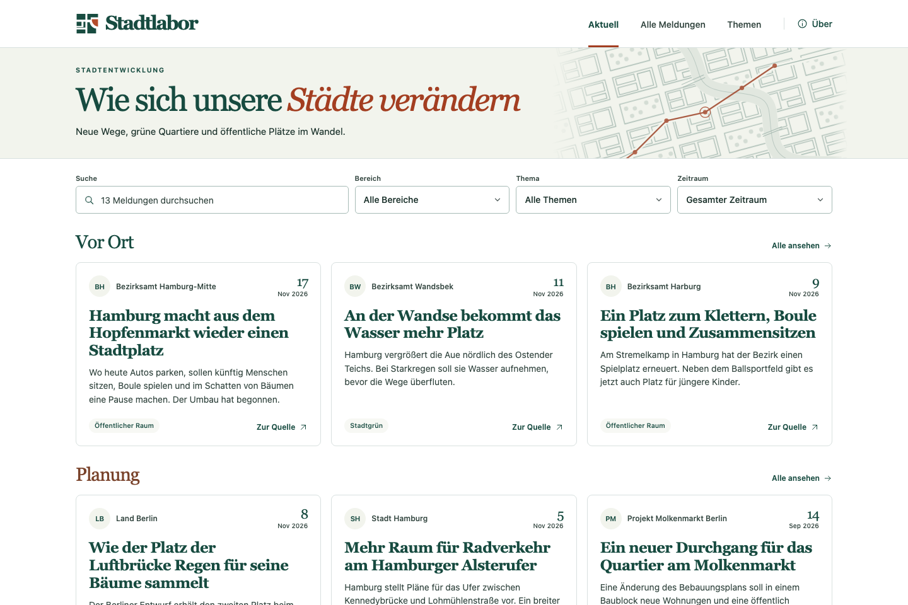
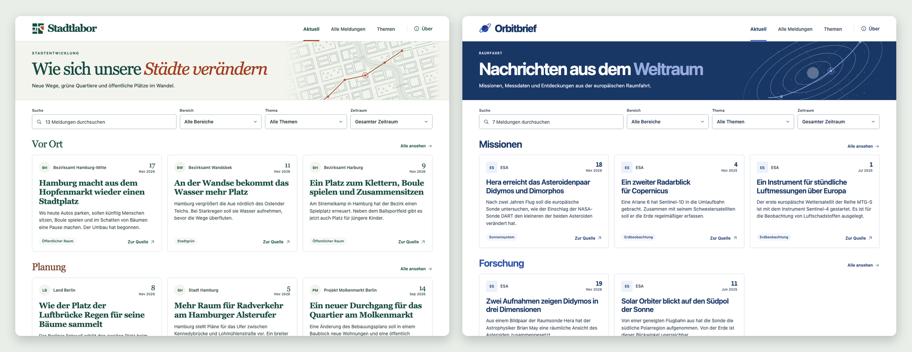

#  Newsfeed OS

Mit Newsfeed OS erstellst du in ChatGPT eine Nachrichtenseite zu deinem Thema. Du wählst Name, Gestaltung und Quellen. Deine Leser können Meldungen durchsuchen, nach Themen filtern und die Originalquelle öffnen. Das Vorbild ist [Patientensteuerung.org](https://patientensteuerung.org/).

## Stadtlabor ausprobieren

**[Stadtlabor in ChatGPT Sites öffnen](https://stadtlabor-newsfeed-demo.timofrank.chatgpt.site)** · [Beide Beispiele herunterladen](docs/demos/Newsfeed-OS.zip?raw=true)

Die Webadresse ist nur für den Inhaber dieser Demo zugänglich. Mit dem Download kannst du beide Beispiele direkt auf deinem Rechner ausprobieren. Entpacke das Paket und öffne **Stadtlabor.html** oder **Orbitbrief.html** im Browser. Suche in Stadtlabor zum Beispiel nach **Hopfenmarkt** und öffne die Meldung.

<a href="https://stadtlabor-newsfeed-demo.timofrank.chatgpt.site"><picture><source media="(max-width: 600px)" srcset="docs/mobil.png"></picture></a>

[Startseite als Bild ansehen](docs/startseite.png) · [Mobile Vorschau](docs/mobil.png)

## Deine eigene Website mit ChatGPT starten

1. Lade das [Vorlagenpaket](docs/demos/Newsfeed-OS.zip?raw=true) herunter. Öffne [ChatGPT](https://chatgpt.com/), wähle **Work** und füge das Paket und, falls vorhanden, dein Logo hinzu.
2. Kopiere den Auftrag unten und ersetze **[mein Thema]**. ChatGPT richtet die Website mit dir ein und übernimmt das Hosting über **Sites**.
3. Öffne den privaten Link, den ChatGPT dir gibt. Prüfe die Startseite, die Filter und eine Originalquelle. Weitere Wünsche kannst du im selben Chat beschreiben.

```text
@Sites, erstelle aus der angehängten Newsfeed-OS-Vorlage eine eigene Website
für [mein Thema]. Verwende die Website im Ordner vorlage/ als Ausgangspunkt.
Frag mich nach Name, Zielgruppe und Quellen. Stimme Logo, Farben und Themen
mit mir ab. Übernimm Suche, Archiv und Quellenlinks. Entferne die Beispielmeldungen
und zeige mir einen ersten Beitrag aus einer meiner Quellen zur Prüfung.
Hoste die Website zunächst nur für mich und gib mir den geprüften Link.
```

[Eigene Ausgabe gestalten, hosten und pflegen](docs/eigene-ausgabe.md) · [Recherche in ChatGPT automatisieren](docs/quellen-beobachten.md)

| Zwei Designs für dieselbe Vorlage | So sehen die Filter aus |
| --- | --- |
| [](docs/ausgaben.png) | [](docs/filter.png) |

Weitere Vorschaubilder findest du für das [Archiv](docs/archiv.png), die [Themenübersicht](docs/themen.png), das Thema [Stadtgrün](docs/thema-stadtgruen.png) und eine [einzelne Meldung](docs/meldung.png).
