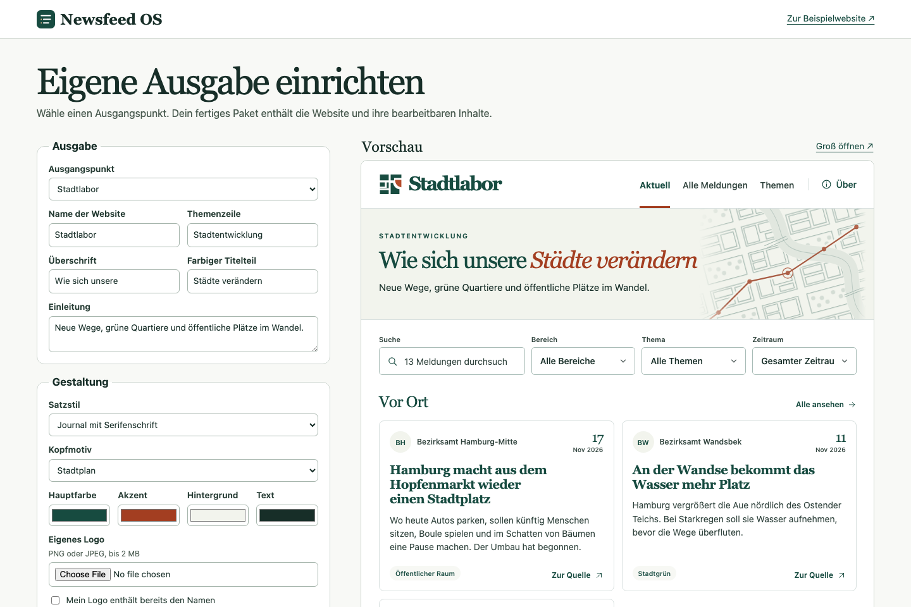
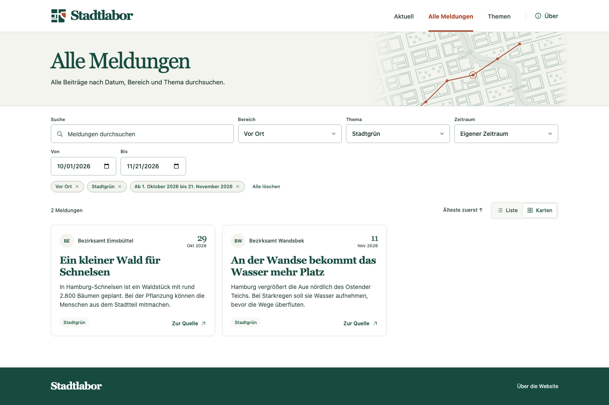

#  Newsfeed OS

Baue eine Nachrichtenseite für ein Thema, das du regelmäßig verfolgst. Du bestimmst, welche Quellen und Meldungen hineingehören. Deine Leser finden die neuesten Beiträge auf der Startseite, können das Archiv durchsuchen und mit einem Klick die Originalquelle öffnen.

**Stadtlabor** zeigt eine Ausgabe zur Stadtentwicklung. Der Aufbau stammt von [Patientensteuerung.org](https://patientensteuerung.org/).

<a href="docs/startseite.png"><picture><source media="(max-width: 600px)" srcset="docs/mobil.png"></picture></a>

[Zweites Design für Raumfahrt](docs/orbitbrief.png) · [Mobile Ansicht](docs/mobil.png) · [Themeneinstieg Stadtgrün](docs/thema-stadtgruen.png) · [Einzelne Meldung](docs/meldung.png)

## Deine eigene Ausgabe starten

1. Klicke auf GitHub auf **Use this template** und lade deine Kopie herunter. Zum Ausprobieren genügt auch **Code → Download ZIP**. Entpacke das ZIP.
2. Öffne ein Terminal im Projektordner und starte die Vorschau mit Python ab 3.9.

   ```sh
   python3 start.py
   ```

3. Öffne [Eigene Ausgabe einrichten](http://127.0.0.1:8765/einrichten/). Wähle Name, Logo, Farben und Themen. Mit **Website herunterladen** erhältst du die fertige Website für deinen Webserver.

| So gestaltest du deine Ausgabe | So finden Leser passende Meldungen |
| --- | --- |
| [](docs/einrichten.png) | [](docs/filter.png) |

[Die erste eigene Meldung eintragen und veröffentlichen](docs/eigene-ausgabe.md#die-erste-meldung-ver%C3%B6ffentlichen)

## Neue Meldungen automatisch finden

Für den **Orbitbrief** kann ein Rechercheagent zum Beispiel jeden Werktag um 08:30 Uhr die Nachrichten von ESA und DLR lesen. Er öffnet die Originalquellen, vergleicht sie mit den vorhandenen Meldungen und schlägt neue oder geänderte Beiträge vor. Du entscheidest, welche davon auf deiner Website erscheinen.

Die [Anleitung zur automatischen Recherche](docs/quellen-beobachten.md) zeigt, wie du Quellen und Zeitplan festlegst, einen ersten Lauf prüfst und die Ergebnisse in deinen Feed übernimmst. Den Beispielauftrag kannst du kopieren.
