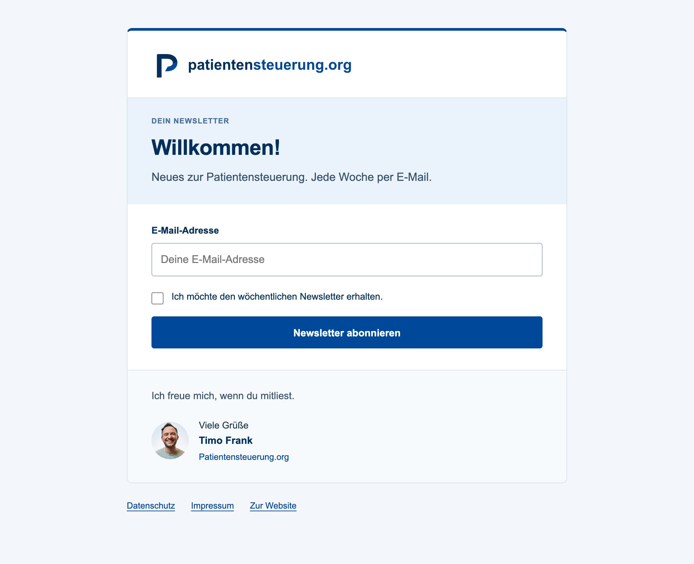
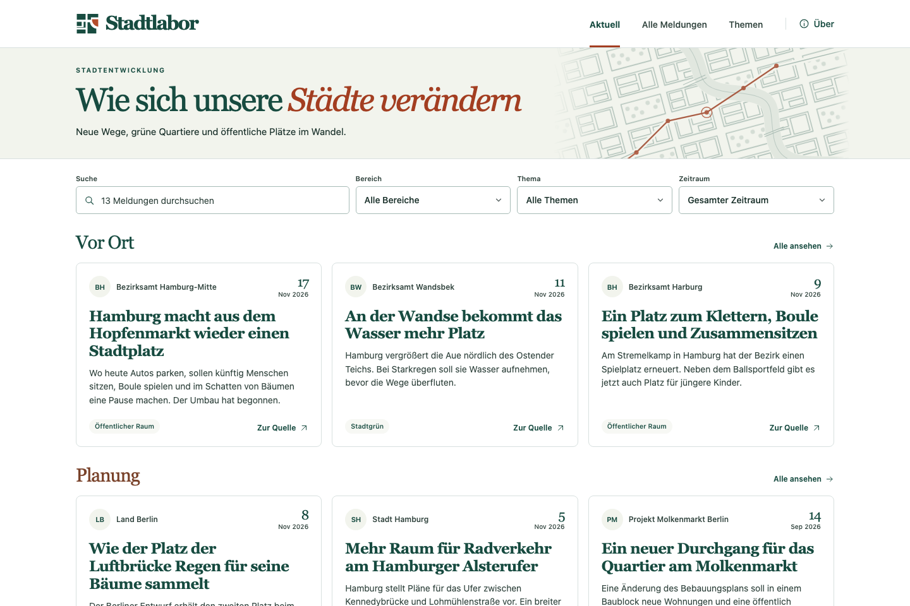
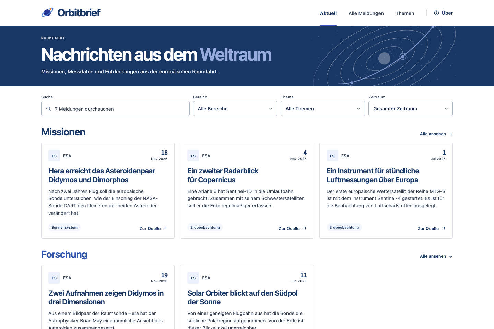
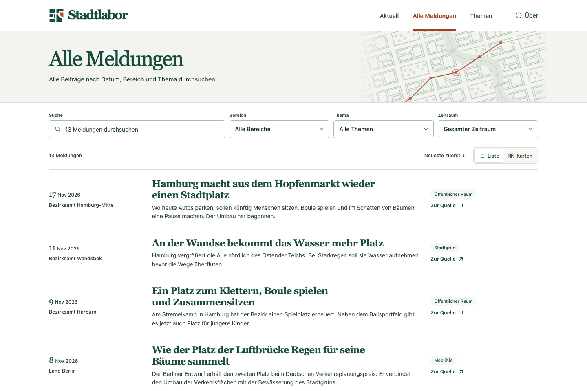
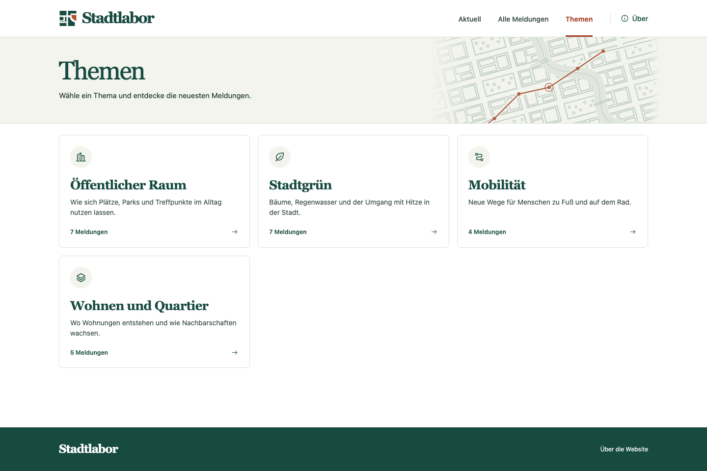
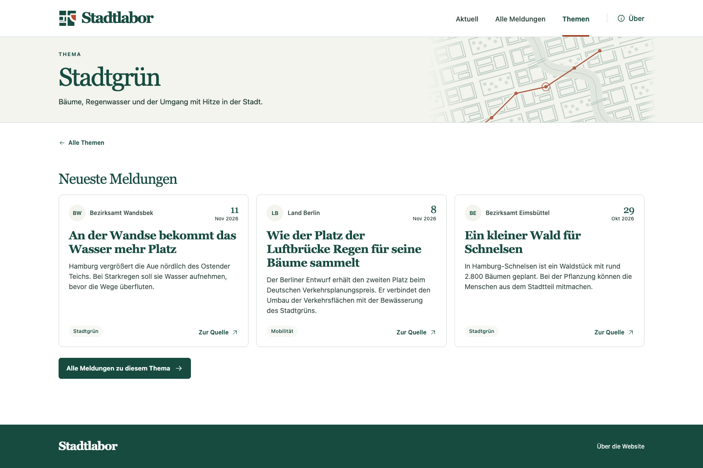
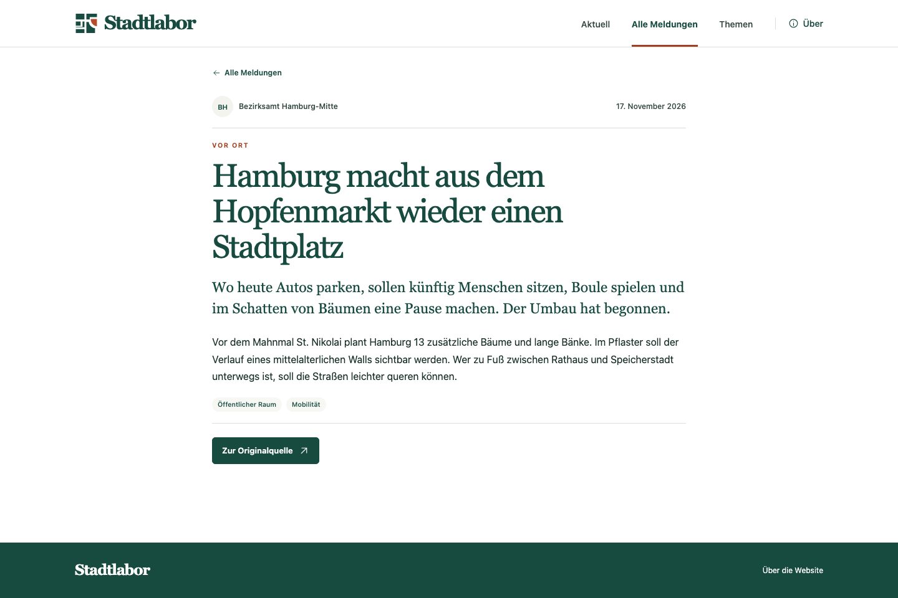

# Die Website in Bildern

[Patientensteuerung.org](https://patientensteuerung.org/) ist das Vorbild für Newsfeed OS. Jedes Bild öffnet sich per Klick in Originalgröße.

## Patientensteuerung.org

**Startseite.** Unter der Suche stehen die aktuellen Meldungen mit Datum und Quelle.

**Themenfilter.** Für „Primärversorgung“ zeigt die Website hier vier Treffer. Der Chip über den Meldungen zeigt die aktive Auswahl.

**Auf dem Handy.** So erscheinen die Suche und die ersten Meldungen auf einem schmalen Bildschirm.

**Newsletter.** Das Original hat einen eigenen [Einstieg für den wöchentlichen Newsletter](https://patientensteuerung.org/newsletter/).

## Beispiele für andere Themen

**Stadtlabor.** Die Ausgabe für Stadtentwicklung nutzt warme Grüntöne und einen Stadtplan im Kopfbereich.

**Orbitbrief.** Die Raumfahrtausgabe zeigt denselben Aufbau mit eigener Schrift, Farbwelt und einem Motiv aus Umlaufbahnen.

## Unterseiten der Beispielausgabe Stadtlabor

**Archiv.** Unter „Alle Meldungen“ lassen sich Beiträge chronologisch durchsehen.

**Themenübersicht.** Über die Themenkarten gelangen Leser zu den Beiträgen eines Themas.

**Themenseite.** „Stadtgrün“ bündelt Meldungen zu Bäumen, Hitze und Regenwasser.

**Einzelne Meldung.** Unter der Einordnung führt ein Link zur Originalquelle.

[Eigene Website mit ChatGPT einrichten](eigene-ausgabe.md) · [Zur README](../README.md)
