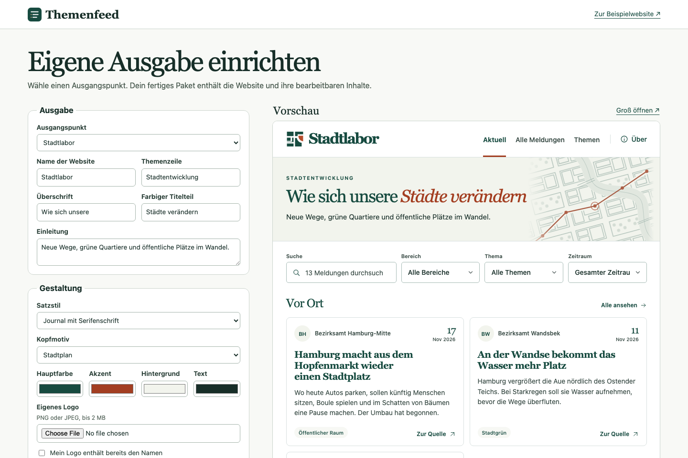

# Eine eigene Ausgabe einrichten

## Ausprobieren

Starte im heruntergeladenen oder geklonten Repository `python3 start.py`. Öffne dann [Stadtlabor](http://127.0.0.1:8765/) oder [Orbitbrief](http://127.0.0.1:8765/?profil=orbit). Beide Beispiele enthalten eine feste Auswahl datierter, öffentlich belegter Meldungen. Über **Zur Quelle** gelangst du zur jeweiligen Veröffentlichung.

## Name, Logo und Themen wählen

1. Öffne [Eigene Ausgabe einrichten](http://127.0.0.1:8765/einrichten/). Wähle eine der beiden Ausgaben als Ausgangspunkt.
2. Trage Namen, Überschrift und Einleitung ein. Wähle Schriftstil, Motiv und Farben. Lade dein Logo als PNG oder JPEG hoch. Bei einer Wortmarke aktiviere **Mein Logo enthält bereits den Namen**.
3. Trage unter **Themen und Meldungen** die gewünschten Bereiche und Themen ein. Jede Meldung gehört zu genau einem Bereich und kann mehrere Themen haben. Für einen leeren Start entferne das Häkchen bei **Beispielmeldungen in meine Ausgabe übernehmen**.
4. Ergänze unter **Herausgeber und Links** die Angaben deiner Redaktion und bei Bedarf Links zu Impressum, Datenschutz oder einem vorhandenen Newsletter. Prüfe die Ausgabe mit **Vorschau aktualisieren**.
5. Wähle **Website herunterladen**. Entpacke das ZIP. Es enthält deine Ausgabe, die bearbeitbaren Inhalte und alle Dateien für den Webserver.

## Die erste Meldung veröffentlichen

Im entpackten Paket beschreibt `profiles/ausgabe.json` deine Website. Dort findest du unter `sections` die Kennungen der Bereiche und unter `topics` die Kennungen der Themen. Im Feed stehen die Beiträge. Ein Beispiel aus dem Stadtlabor zeigt die [vollständige Datenstruktur](../feeds/stadtlabor.json).

1. Öffne `feeds/meldungen.json`. Für den ersten Beitrag kannst du einen Eintrag aus dem Beispiel übernehmen. Belasse die äußeren eckigen Klammern. Zwischen zwei Beiträgen steht ein Komma.
2. Gib dem Beitrag eine eindeutige, dauerhafte `id`, etwa `neuer-stadtplatz`. Ergänze `title`, `summary`, `body` und das Veröffentlichungsdatum als `YYYY-MM-DD`. Trage bei `section` eine Bereichskennung und bei `topics` die passenden Themenkennungen ein. Unter `source` stehen Name und URL der Originalquelle.
3. Starte im entpackten Ordner `python3 -m http.server 8000 --bind 127.0.0.1` und öffne [die lokale Ansicht](http://127.0.0.1:8000/). Prüfe den neuen Beitrag im Archiv und öffne die Originalquelle.
4. Zum Veröffentlichen kopierst du den Inhalt des entpackten Ordners in das Webverzeichnis deiner Domain oder eines Unterpfads. Neue Beiträge erscheinen, sobald du die geänderte Feeddatei dort bereitstellst. Python wird nur für die lokale Vorschau benötigt.

Wenn dein Redaktionssystem bereits JSON bereitstellt, kannst du im Profil bei `feed` auch dessen URL im selben Datenformat eintragen. Bei einem anderen Ursprung muss der Datenanbieter Browserzugriffe von deiner Website über CORS zulassen. Die Reihenfolge ergibt sich aus dem Datum.

## Profile direkt bearbeiten

Im Vorlagenrepository wählt [site.json](../site.json) den Standard. Jedes registrierte Profil hat eine eigene JSON-Datei, einen öffentlichen Feed und optional ein Logo. Kopiere für eine weitere Ausgabe beispielsweise das [Stadtlabor-Profil](../profiles/stadtlabor.json), passe den Feedpfad an und trage die neue Profilkennung in `site.json` ein. Ein Link mit `?profil=deine-kennung` öffnet die Ausgabe. Einmal geteilte Meldungslinks bleiben beim Ändern eines Titels gültig, solange Profilkennung und Meldungskennung gleich bleiben.

[Zurück zur Übersicht](../README.md)
